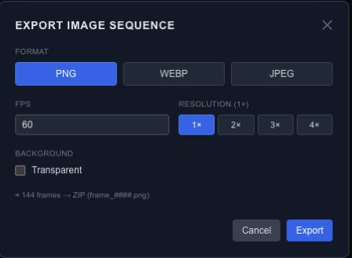

# Export an animation as an image sequence

An image sequence turns the animation into individual frames. Use it when another application will assemble the frames into a video or when you need direct control over every rendered frame.

## Choose the frame settings

Open image-sequence export and choose PNG, WebP or JPEG. Use PNG or WebP with **Transparent** enabled when you need an alpha channel. JPEG has no alpha channel; transparent areas export over white.

Set **FPS** to the frame rate you will use in the receiving application. Choose **Resolution** from 1× to 4×: at 2×, a 1920 × 1080 composition produces 3840 × 2160 frames. Higher resolution makes each frame larger; a higher frame rate produces more frames.

Review the composition duration and the estimated frame count before starting. For example, a four-second composition at 30 FPS produces 120 frames. Exporting a long animation at a high frame rate can create many files even when the composition looks simple.

## Check the downloaded archive

The download is a ZIP archive with numbered files such as `frame_0001.png`. Extract it and inspect the first, middle and last frames. Keep the filenames in order when importing them into another tool. Use the same frame rate there so the animation does not play faster or slower than intended.

The sequence contains rendered pictures, not editable layers or interactive behavior. Save an [editable project](export-project-json.md) alongside it, or use [runtime JSON](export-runtime-json.md) for a player-driven result.

## Check frame timing and preparation

Frame `i` is evaluated at `i / fps * 1000` milliseconds. This makes sampling independent of how smoothly the editor happens to play in the browser. A sequence is limited to 4096 frames; shorten the duration or lower FPS if the request exceeds that limit.

Every frame uses the full composition and original sources, including content hidden only by workspace isolation or viewport culling. Media, font and video-frame preparation must complete before drawing. A failed preparation is reported rather than silently producing a blank successful frame.

Use PNG or WebP for alpha. JPEG flattens transparent output onto white. Scales above 1× currently upscale the rendered bitmap; use the [image export guidance](export-images.md#match-export-to-the-full-composition) to choose dimensions before producing a long sequence.
