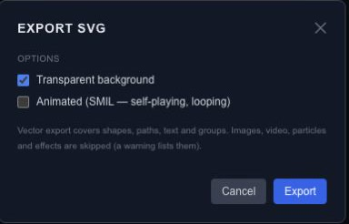

# Export a scene as SVG

Choose SVG when vector geometry is the useful output. It can preserve scalable paths and shapes, but it should not be treated as a portable copy of every editor feature.

## Export the intended frame

Set the playhead to the moment you want and open SVG export. Leave **Animated** unchecked to export a still frame. Enable **Transparent background** when the SVG should sit over another page or design.

For a looping animation, turn on **Animated (SMIL)**. Chorono converts supported transform and opacity tracks into animation inside the SVG file. It plays without the Chorono runtime in a viewer that supports SMIL; it does not carry the editor's state machines or interactions.

## Check what SVG can preserve

SVG export covers shapes, paths, text and groups. Images, video, particles and effects are skipped, and the export warnings identify unsupported content. Review those warnings before treating the download as a faithful copy of the scene.

## Inspect the result

Open the downloaded file in the application or browser where it will be used. Compare dimensions, text, strokes, clipping and effects with the editor. A supported static shape and a filtered or media-rich scene have different conversion needs.

If the visual result matters more than vector editability, use a [still image](export-images.md). For Chorono playback and interaction, export [runtime JSON](export-runtime-json.md). Keep the editable project regardless of which output you share.
