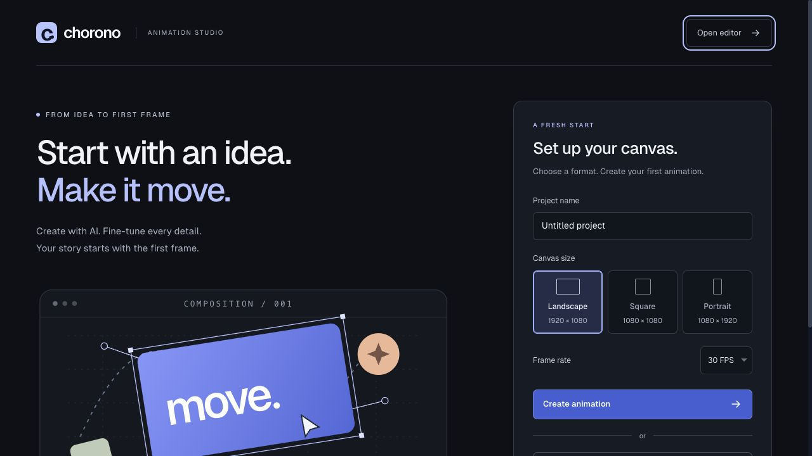

# Install Chorono on your computer

[Documentation](../README.md) · [Türkçe](../tr/installation.md) · [Agent skills](agent-skills.md) · [Troubleshooting](troubleshooting.md)

This guide installs the browser editor, its local MCP bridge and the skills an agent uses to create editable animations. The commands run from a GitHub checkout and do not require the Chorono CLI to be published on npm.

## Requirements

- Node.js **20 or later**, with npm. Check with `node --version` and `npm --version`.
- Git, checked with `git --version`.
- A modern browser; WebGL2 enables GPU rendering.
- Codex, Claude Code or Claude Desktop if you want agent control. Install your chosen client separately.
- Internet access for the initial Git download and npm dependencies.

Use Terminal on macOS/Linux or PowerShell on Windows. The commands below work in either shell. Quote paths containing spaces. No provider API key is needed for the external agent's MCP workflow; the editor's built-in AI panel has separate optional provider settings.

## 1. Download and prepare the editor

Choose a folder for the source checkout, then run:

```sh
git clone https://github.com/codie1982/chorono-editor.git
cd chorono-editor
npm ci
npm run cli:build
npm run chorono -- setup
```

`cli:build` prepares the CLI's bundled skills from the canonical `skills/` directory. `setup` builds missing MCP/editor outputs, creates local bridge credentials, configures MCP clients and installs skills. It preserves existing checkouts and client entries. If a client is reported as `stale` or `unverified`, use [troubleshooting](troubleshooting.md) to review its entry.

The default setup targets all three MCP clients. To configure one, replace the setup command with one of these alternatives:

```sh
npm run chorono -- setup --agent codex
npm run chorono -- setup --agent claude-code
npm run chorono -- setup --agent claude-desktop
```

Run only the alternative for your client. Codex and Claude Code receive filesystem skills; Claude Desktop receives an MCP configuration and uses its own supported skill import method.

## 2. Start and connect

```sh
npm run chorono -- start --background --open
```

Open the URL printed by the command, normally `http://127.0.0.1:2000`. The welcome screen lets you choose a canvas preset or open an existing project.



In the editor choose **MCP → Connect this editor**. Reload MCP connections in your agent client, or start a new agent session after setup changes the configuration. A refreshed browser tab must be connected again.

```sh
npm run chorono -- doctor
```

Doctor checks dependencies, builds, selected client settings, server identity and connected editor count. It exits with code 1 until ready. For setup limited to one client, use the same selector, for example `npm run chorono -- doctor --agent codex`.

Ask the agent to check `list_sessions`, `get_capabilities` and `get_scene`. A healthy HTTP server alone does not prove the browser or this chat is connected. With multiple editor tabs, select the intended `sessionId`.

## 3. Create your first animation

For a manual first edit, open the [first-animation tutorial](getting-started.md). To work with an agent, use the [MCP connection guide](connect-ai-agent.md) to verify the live editor session before sending a brief.

In your agent client, ask:

> Use Chorono to create a 1920 × 1080 scene with a title and three circles. Add separate intro, idle and outro animations. Inspect preview images at representative times, validate the scene and save the portable editable project. Report the saved path.

The agent uses `chorono-setup` for connection work and `chorono` for scene authoring. Saved projects go under `<animation-project>/projects/`; exports go under `projects/exports/`. Keep a portable project for later editing.

## Use a separate animation project

The commands above use the checkout as the animation project. To keep work elsewhere, run the following from the editor checkout, replacing the example with your chosen path:

```sh
npm run chorono -- setup --project "../my-animation" --agent codex
npm run chorono -- start --project "../my-animation" --background --open
npm run chorono -- doctor --project "../my-animation" --agent codex
```

Setup creates the project directory if necessary and remembers its editor and port in `.chorono/installation.json`. Keep passing the same project path to start, doctor and stop. `--editor PATH` selects an existing checkout explicitly. When no checkout is found, setup can download one into `<project>/.chorono/editor`; `--repo URL --ref BRANCH_OR_TAG` selects the source for a fresh download. Existing checkouts are never pulled or reset automatically.

## Where files are installed

| Item | Default location |
| --- | --- |
| Codex project skills | `<project>/.agents/skills/` |
| Claude Code project skills | `<project>/.claude/skills/` |
| Claude Code MCP configuration | `<project>/.mcp.json` |
| Codex MCP configuration | `~/.codex/config.toml`, or the configured `CODEX_HOME` |
| Claude Desktop configuration on macOS | `~/Library/Application Support/Claude/claude_desktop_config.json` |
| Claude Desktop configuration on Windows | `%APPDATA%/Claude/claude_desktop_config.json` |
| Claude Desktop configuration path generated on Linux | `~/.config/Claude/claude_desktop_config.json` |
| Generated MCP snippets | `<editor>/.chorono/client-configs/` |
| Background server log | `<editor>/.chorono/editor.log` |

These are the CLI's configuration targets; they do not install the agent client itself. Tokens and configuration backups are private local files under `.chorono/`; keep them out of Git and shared reports.

## Stop, restart and rebuild

```sh
npm run chorono -- stop
npm run chorono -- start --background --open
```

Stop only manages a matching background process created by this CLI. Stop a manually launched Next server in its original terminal. **Stop the Next server before installing dependencies or building.** Then, when needed:

```sh
npm run chorono -- setup --rebuild
```

Add `--reinstall` to setup if dependencies also need refreshing. For a separate project, include its `--project` path. The CLI reuses a matching server and refuses to replace another service on an occupied port.

For automated diagnostics, use `npm run --silent chorono -- doctor --json`; npm's silent flag keeps its banner out of JSON stdout. See the [CLI package](../../packages/cli/README.md) and [distribution guide](../tr/skills.md) for installed CLI and local tarball usage.
