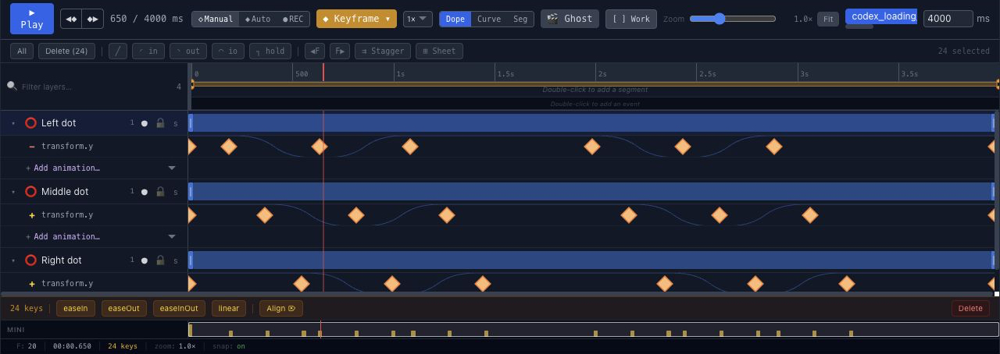

# Make a looping animation in Chorono

[Documentation](README.md) · [First animation](getting-started.md) · [Timeline](editor-timeline.md)

A looping animation repeats a sequence. A clean loop also makes the end join the beginning without an unintended jump. In this tutorial, inspect a four-second loading animation, change its movement and save an editable copy.

## Open the example

1. [Install and start Chorono](installation.md) if you have not already.
2. [Preview the three-dot loading loop](https://www.chorono.com/blog/make-animations-with-codex#animation-example).
3. [Download the portable project](https://www.chorono.com/examples/codex-loading-loop.chorono.json). Save it as `codex-loading-loop.chorono.json` if your browser displays the JSON.
4. Open a separate editor tab and choose **Menu → Open Scene JSON**. Select the downloaded file.
5. Select the `codex_loading_loop` timeline and play it for at least two full cycles.

This is the existing example from the Codex guide. It uses a 1024 × 768 composition at 30 fps, four named layers, three vertical-position tracks and 24 keyframes. It has no external image, audio or font assets. You can edit it manually without an agent.

## Read the loop timing

Use the [keyframe editing guide](editor-keyframes.md) to find the property track, and the [timeline guide](editor-timeline.md) to compare times before changing the example.

The headline stays still. Each dot starts at `y = 438`, rises to `y = 398`, then returns. Canvas coordinates increase downward, so reducing y moves a dot upward. These are composition pixels; the displayed preview may be scaled.

The following values come from the downloadable project's first wave:

| Layer | Hold until | Highest point | Back at rest |
| --- | --- | --- | --- |
| Left dot | 200 ms | 650 ms: y = 398 | 1100 ms: y = 438 |
| Middle dot | 380 ms | 830 ms: y = 398 | 1280 ms: y = 438 |
| Right dot | 560 ms | 1010 ms: y = 398 | 1460 ms: y = 438 |

Each dot follows the preceding dot by 180 ms. The second wave reaches its highest points at 2450, 2630 and 2810 ms. All three position tracks begin and end at `y = 438`; their last keyframes are at 4000 ms. The timeline has `loop: true`.

The movement uses `easeInOut`. In Chorono, a keyframe's easing controls the interval leaving that keyframe. The equal resting values create still intervals before, between and after the waves. See the [easing comparison](https://www.chorono.com/animation-easing) for how curves change progress between two values.

## Reduce the movement

Select **Left dot** and expand its vertical-position track. Change the two peak values at 650 and 2450 ms from 398 to 418. Keep its resting values at 438.

This reduces the upward travel from 40 pixels to 20 pixels without changing the duration. To apply the same revision to every dot, change the peaks at 830 and 2630 ms on **Middle dot**, then 1010 and 2810 ms on **Right dot**.

Keep the 180 ms delay between dots. Do not move all their peaks to the same time unless you want the dots to move together.

## Check the loop boundary

Inspect the timeline around 3967 ms, then 0 and 33 ms. At 30 fps these are approximately the neighboring displayed frames around the four-second wrap. Playback may wrap exactly 4000 ms to zero, so inspecting only the endpoint can hide the join.

Check that every dot is at rest before the wrap, that the headline remains still and that the next cycle begins as intended. Play at least two cycles after the revision.

Matching endpoint positions prevents a positional jump, but does not guarantee smooth speed. This example has a resting interval at the boundary. For a continuously moving loop, also check direction and speed across the join.

## Make the same edit with an AI agent

After [connecting the editor through MCP](installation.md#2-start-and-connect), give your agent a specific revision:

> Read the open three-dot loading scene and the codex_loading_loop timeline. On Left dot, Middle dot and Right dot, change only the two peak y values from 398 to 418. Keep all resting y values at 438, the existing keyframe times, easeInOut easing, the 180 ms stagger, headline and four-second loop. Preserve unrelated layers and timelines. Inspect real previews near 0, 1000, 3000 and 3967 ms, validate and save a separate portable revision. Report the path.

The download contains the original 40-pixel movement. This prompt describes a revision you make after opening it.

## Save and reopen your revision

Choose **Menu → Save Scene JSON** and use a name such as `loading-loop-small-motion.chorono.json`. Reopen that file in a separate editor tab and check the changed peaks and the loop boundary again.

Keep the portable project as the editable source. A runtime export is a separate playback artifact; it is not an MP4 file or a ready-made accessible loading component.

## Use a loading loop responsibly

This animation is a motion study, not a measurement of a running task. In an application, show a loading state only while work is pending and stop it when the operation finishes. Use a determinate progress bar when you can report actual progress.

Keep status text outside a canvas, provide playback controls for demonstrations and respect reduced-motion preferences. For a simple three-dot indicator, CSS may satisfy the application better; Chorono is useful when you need an editable scene or coordinated motion.

Next, compare [progress and success animations](https://www.chorono.com/blog/progress-bar-and-success-animation), or inspect the [keyframes in a title entrance](https://www.chorono.com/keyframe-animation).
