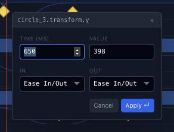

# Real screenshots in the handbook

Nine reviewed captures from the real Chorono editor illustrate six English guides:
installation, first animation, keyframes, timeline, loops and MCP. The existing
animation poster/player stays separate; these figures explain the actual editor UI.

## Ownership and rendering

- `public/docs/screenshots/` owns the original JPEG assets. Controls, labels and
  values are captured from the application, never reconstructed or painted over.
- `lib/documentation/screenshots.ts` owns an exact allowlist of repository paths,
  public URLs and measured intrinsic image dimensions.
- `lib/documentation/content.ts` extends the existing Markdown link resolver so
  reviewed relative image paths resolve locally. Other repository links retain
  their existing behavior; raw HTML remains disabled.
- `DocumentationMarkdown` renders standalone reviewed images as figures outside
  paragraphs. Inline images remain phrasing content; existing scene previews
  keep their behavior.
- `DocumentationScreenshot` is a server component with article-owned alt text and
  captions, intrinsic aspect ratio, lazy responsive Next Image variants and a
  keyboard-accessible link to the original JPEG in a new tab. The link label sits
  below the image so it cannot cover native editor controls. Small dialog images
  do not upscale. There is no additional client dependency or zoom-modal lifecycle.

Use a reviewed filename, relative to `docs/en/`:

```md

```

The Markdown title supplies the caption. Only allowlisted screenshots receive this
figure presentation. There are ten screenshot placements across the six guides;
the same loop timeline capture supports both the timeline and loop explanations.

## Source states

Captured on 9 November 2026 from the unchanged downloadable projects.

| File | Actual state | Dimensions |
| --- | --- | --- |
| `welcome.jpg` | Welcome screen, canvas presets and Create animation | 1280 × 720 |
| `first-animation-editor.jpg` | first-animation at 1800 ms; Editable headline selected and Content visible | 1280 × 720 |
| `timeline-panel-v2.jpg` | codex_loading_loop at 650 ms; Timeline and three transform.y tracks | 1280 × 489 |
| `dope-sheet-panel-v2.jpg` | Same loop; dedicated Dope Sheet with layer/property hierarchy and filters | 1280 × 489 |
| `curve-editor-panel-v2.jpg` | Left dot transform.y; resting value 438 and two dips to 398 | 1280 × 489 |
| `keyframe-inspector-v2.jpg` | Left dot peak before editing; Time 650 ms / Value 398 | 292 × 222 |
| `keyframe-spreadsheet-v2.jpg` | Original loop with all 24 keys selected; Track, Time, Value and Easing columns | 1280 × 197 |
| `loop-timeline-v2.jpg` | Same loop and playhead; staggered position tracks across four seconds | 1280 × 454 |
| `mcp-connect-v2.jpg` | Disconnected dialog before Connect this editor; no connection claim | 528 × 306 |

The dedicated Dope Sheet is distinct from Timeline's Dope display button. Captions
name the actual source example and distinguish current values from proposed edits.
Do not reuse a capture for a different example, value or connected-state claim.

## Recapture and maintenance

Use a separate editor tab and preserve unrelated sessions. Load a copy of the
existing public example through the native Chorono MCP workflow, inspect the real
UI state and compare the scene data against the original afterward. Pause playback
and disconnect only the capture tab when finished. Never execute generated scene
code in Node or modify the browser DOM to create screenshots.

The MCP dialog capture contains no active session ID, token, filesystem path or
agent account. The original downloadable projects are unchanged. When editor UI
changes, replace the relevant capture, intrinsic dimensions and caption together.

On the capture backend, a screenshot clip accepted x/y but returned top-left
pixels. The verified component assets therefore use full CUA browser captures and
deterministic macOS sips rectangle crops. No UI pixels are synthesized. Example
for a measured panel origin at y=230 in a 1280 × 720 capture:

```sh
sips -c 489 1280 --cropOffset 230 0 -s formatOptions best full-editor.jpg --out timeline-panel-v2.jpg
```

Keep the rectangle inside the source bounds and inspect the output pixels; this
sips version left the source uncropped when the crop's lower edge equalled the
source height. Versioned public filenames prevent old optimized crops from being
reused. Full originals and retired crops remain in ignored local outputs.

## Verification

Run `npm test`, `npm run build` and `scripts/docs/inspect.py` against the owned
website server. Stop that server before building; keep the separate editor running.
Review all nine original assets, ten rendered figures, alt text, captions, image
sizes, responsive requests, full-size links and paragraph/figure nesting. Check
internal links including `/docs/releases/0.2.0`, plus desktop and narrow layouts.
The docs crawler excludes screenshot media from its HTML graph; check JPEG and
optimized-image responses separately.

This addition preserves the shared production publication gate and sitemap
inventory. Local HTML timing samples are not field Core Web Vitals measurements.
